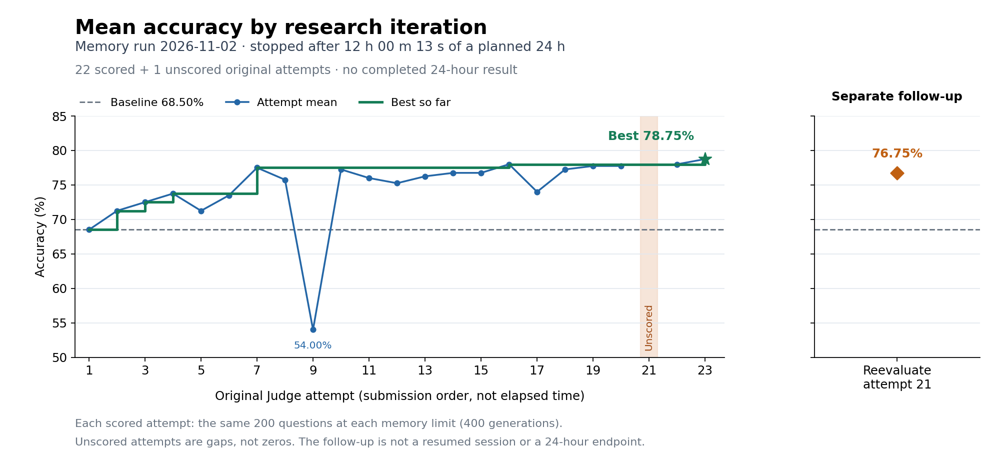
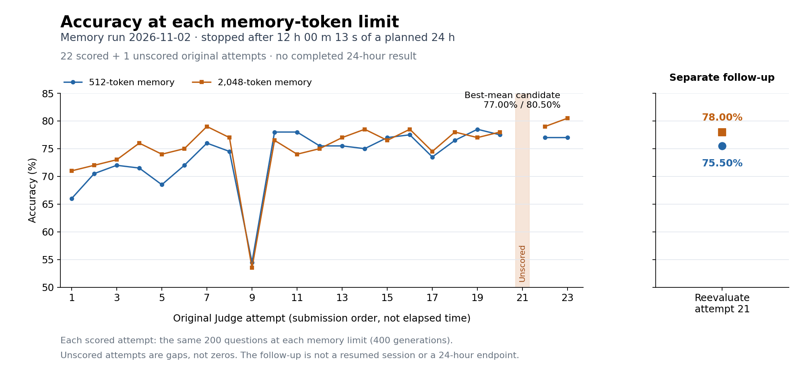

# Preliminary Memory results: interrupted 24-hour experiment

These are the measured results of the selected **2026-11-02 Budgeted Reasoning Memory run**, which stopped early. They are not results from a completed 24-hour experiment. The proposed seeded continuation was cancelled before launch.

## Approximately 12 hours versus the planned 24 hours

| Checkpoint / scope | Charged Agent time | Scored / unscored attempts | Mean accuracy | Interpretation |
| --- | --- | --- | --- | --- |
| Starter baseline, original attempt 1 | Included in the original run | Included in the counts below | 68.50% | Same fixed evaluation protocol |
| Original run at its stop, approximately 12 hours | 43,213.354687489 s = 12 h 00 m 13.354687489 s | 22 / 1 | **Best: 78.75%** | Best and final scored submission was attempt 23; +10.25 percentage points over baseline |
| Intended 24-hour endpoint | Planned: 86,400 s; 43,186.645312511 s unused | No completed endpoint; one original attempt slot unused | **Not available** | The second VM failed during guest boot before native resume |
| Separate reevaluation after shutdown | Outside the original Agent trajectory | 1 / 0 additional attempt | 76.75% | Reevaluated original unscored attempt 21; did not improve the best |

The official stage-1 checkpoint result has status `cancelled`. An uncaught 10-second SSH-readiness timeout aborted the second VM's guest boot. The approximately 12-hour row is the measured stopping point, not a preplanned exact 12-hour checkpoint. Charged Agent time is the run's budget-accounting quantity, not a reconstruction from wall-clock submission times.

The original run has **23 attempts total**: 22 scored (including baseline attempt 1) and one unscored. Including the separate follow-up, there are 24 attempts total, 23 scored and one unscored. This does **not** mean that the original research session used its 24th slot or completed 24 hours. The follow-up neither fills in the original timeout retroactively nor extends the research trajectory.

## Performance by iteration

Each x-axis step is an original Judge attempt in submission order; it is not equal elapsed time or an internal research-code iteration. Attempt 21 has no numerical score and appears as a gap. The best-so-far line retains the previous measured best through that gap. The low score at attempt 9 (54.00%) is retained. The follow-up is shown in a separate panel, with no connecting line to the original trajectory.

| Candidate | 512-token memory | 2,048-token memory | Mean |
| --- | --- | --- | --- |
| Baseline / attempt 1 | 132/200 = 66.00% | 142/200 = 71.00% | 68.50% |
| Best original / attempt 23 | 154/200 = 77.00% | 161/200 = 80.50% | 78.75% |
| Separate reevaluation of attempt 21 | 151/200 = 75.50% | 156/200 = 78.00% | 76.75% |

## Data and plot reproduction

- [evaluations.csv](evaluations.csv): all 23 original attempts plus the separate follow-up. Accuracies are fractions in `[0, 1]`; unscored values are empty. `best_so_far` refers only to the original run and includes its baseline. The supplemental row uses its own attempt index 1 and links to `original_attempt=21`.
- [summary.json](summary.json): exact time accounting, counts, explicit null 24-hour result, and hashes identifying the private source review and per-attempt reports. It contains only selected non-secret metadata, not the private trajectory or candidate payloads.
- [plot_results.py](plot_results.py): regenerate both PNG figures locally with Python, matplotlib, and numpy. From this directory, run `python plot_results.py`. This makes no network or model calls.

The plotted original scores were extracted from the preserved final review and cross-checked against the separately saved post-failure monitoring snapshot. All 22 means and both per-budget correct counts agreed. Each mean was recomputed as `(correct_512 + correct_2048) / 400`; every scored budget had 200 questions. The follow-up comes from its separate verification receipt. The mean uses the same questions at both memory limits, so 400 generations are not 400 independent questions.

## Limits

These are **operator-reviewed preliminary measurements**, not independent benchmark validation. The source receipts, raw trajectories, model outputs, and candidate payloads remain private. Their hashes identify the evidence but do not make the experiment independently reproducible. This PR reproduces the **figures from disclosed score summaries**, not the model evaluations.

The underlying workload is public and was repeatedly used for adaptive feedback. This curve does not establish unseen-data generalization, statistical significance, or a causal retrieval benefit. No confidence intervals or extrapolated 24-hour scores are claimed. The earlier independent Memory run is not combined with this run; two interrupted runs would not constitute one continuous 24-hour trajectory. Witness Planning and ACE scores use different tasks/protocols and are not included in these plots.

Completing the agreed research trajectory, publishing the evaluator and baseline, replacing the retired private broker, and obtaining maintainer review remain separate requirements. This results update launches no new experiment.
