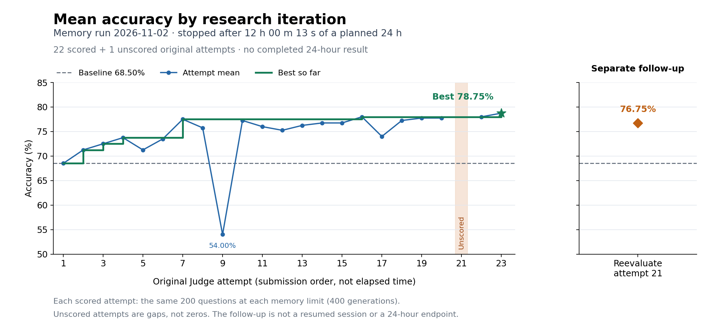

# Draft proposal: Budgeted Reasoning Memory

**Status: proposal for maintainer discussion. This is not an accepted task, a runnable task release, or a completed research trajectory.** This document is AI-assisted and published at the contributor's request. It does not claim to satisfy the PR template's human-authorship questions.

## Why a separate task

The contributor proposes Budgeted Reasoning Memory as an alternative research direction to continuing Observable Witness Planning ([Discussion 298](https://github.com/OpenRSI-Foundation/OpenRSI-Index/discussions/298)). A Witness Planning research run was interrupted by an automated Codex cybersecurity safety flag. That is a recorded execution interruption, not a confirmed security bug in the benchmark, an established false positive, or a maintainer rejection. The precise trigger has not been established.

Memory changes the scientific question: improve a frozen model's numerical reasoning by designing compact memory notes and selecting the notes relevant to each question. It is a separate proposed task, not a repair of Witness Planning or a substitute for that task's missing completed trajectory. The existing Witness Planning proposal and evidence remain separate.

## Proposed scientific contract

The contributor has selected the existing Budgeted Reasoning Memory design as the proposed replacement direction. Fields marked pending are explicit gaps; this draft must not be treated as ready for automatic task generation.

| Section | Field | Proposal |
| --- | --- | --- |
| Contributor | Full name | Purva Chiniya ([GitHub](https://github.com/PurvaChiniya)). Relevant public agent research includes coauthorship of [Open Deep Search](https://arxiv.org/abs/2503.20201). Specific ACE codebase familiarity and the applicable source-project selection route still require confirmation; no ACE authorship is claimed. |
| Contributor | Email | purvachiniya15@gmail.com, previously supplied for public contribution metadata in Discussion 298. |
| Research Question | Repository URL | Inspiration and upstream source: [ace-agent/ace](https://github.com/ace-agent/ace). The [OpenRSI ACE task](https://github.com/OpenRSI-Foundation/OpenRSI-Index/tree/eca7d9e4857900ef8485a1f2137eb51bdc2dcc33/rsi-tasks/ace-playbook-repair) is related work. The separate Memory implementation and baseline are not published by this documentation-only PR. |
| Research Question | Exact commit/tag | Related ACE source: `82709de050e1db6e6ef2f07bcb0393560b94992a`, as pinned by the OpenRSI ACE maintainer guide at Index commit `eca7d9e4857900ef8485a1f2137eb51bdc2dcc33`. A public immutable revision of the Memory overlay is pending. |
| Research Question | Scientific question | Under fixed 512-token and 2,048-token memory budgets, can jointly designed reasoning notes and question-conditioned learned retrieval improve a frozen Qwen2.5-7B-Instruct model's Formula accuracy over matched static-note and keyword-retrieval controls? |
| Research Question | Why this is scientific research rather than pure engineering optimization | Iteratively test hypotheses about note content, query/card representations, relevance, and allocation of scarce context. Use matched ablations to distinguish better notes from better selection. A higher score alone does not establish a causal retrieval benefit. |
| Research Question | Starting environment and artifacts | Fixed Formula workload, tokenizer, frozen Qwen model, inference configuration, baseline memory, and public candidate-format validator. Publication of exact Memory data/model/tokenizer revisions, baseline bytes, and dependency closure is pending. |
| Research Question | Agent's final deliverable | Inert memory-card text plus a bounded, declarative retrieval configuration and optional learned projection matrices, all in WORKDIR. Judge owns parsing, retrieval execution, inference, and scoring; candidate code and self-reported scores are not scoring authority. |
| Research Question | Files/components the agent may modify | Candidate memory cards, permitted retrieval parameters and projections, and research scripts/notes within the declared workspace. Exact portable artifact paths and schema will be published with the overlay. |
| Research Question | Prohibited actions | Changing the frozen model, task data, tokenizer, evaluator, prompts outside the declared memory insertion point, or score aggregation; answer hard-coding, evaluator tampering, fabricated outputs, and undeclared model calls. |
| Reference Baseline | Baseline implementation or artifact | Existing benchmark-owned starter artifact from the Memory experiments. Prior operator-reviewed measurement: 68.5% mean accuracy. Its exact materializable bytes, provenance, and public immutable delivery remain to be published. This is not the ACE task's baseline. |
| Reference Baseline | Repository evidence paths | ACE context: `rsi-tasks/ace-playbook-repair/README.md` at the Index revision above. Memory-specific source, baseline, and evidence paths are pending public packaging; the ACE file is not evidence of Memory's measured score. |
| Reference Baseline | Baseline evaluation path | Evaluate the fixed baseline through the same candidate-only Memory evaluator used for submissions. The portable replay command is pending; do not use the retired private broker as an available reviewer interface. |
| Reference Baseline | Baseline metric reported by the repository | No Memory result is currently established by this upstream repository. The 68.5% value below is a preliminary local experimental result, not independently reproduced maintainer evidence. |
| Evaluation | Fixed evaluation protocol | Evaluate the same 200 Formula questions at both memory limits, producing 400 logical generations per complete scored attempt. Historical configuration used a frozen Qwen2.5-7B-Instruct model, greedy BF16 inference, seed 0, a 1,024-token output limit, and an 8,192-token context limit. Freeze exact revisions, order, prompts, token accounting, and physical-call/retry accounting in the published evaluator before validation. No silent replacement generations or partial-workload scores. |
| Evaluation | Evaluation mode and input | Direct evaluation of the submitted inert memory/retrieval artifact. No evaluator-time training of the language model and no call to the research Agent from Judge. |
| Evaluation | Reward or score definition | Maximize the arithmetic mean of answer accuracy at the 512-token and 2,048-token memory limits. Invalid candidates, infrastructure failures, timeouts, and incomplete evaluations are unscored. A complete valid evaluation with no correct answers scores zero. |
| Evaluation | Feedback visible to the agent | Aggregate overall and per-budget accuracy, artifact-validity diagnostics, and attempt status. The precise permitted diagnostic fields must be frozen before launch. |
| Evaluation | Evaluation information hidden from the agent | Judge-owned answers, per-example correctness, and evaluator internals are not research feedback. However, the underlying Formula questions are public and the prior Memory search repeatedly used this fixed workload; do not describe it as unseen or contamination-free. |
| Evaluation | Measures preventing reward hacking | Strict data-only schema, limits and finite-value checks; frozen evaluator/model/data; fresh Judge with read-only candidate snapshot; task-owned scoring; no trust in candidate logs or claimed rewards. Publish tests of the boundary. Residual risks include public-data exposure and adaptive overfitting to the fixed workload. |
| Evaluation | Noise handling and meaningful improvement | The provisional 68.5% baseline leaves 31.5 percentage points below the metric ceiling. Greedy inference reduces sampling variation but is not proof of cross-hardware determinism. Establish observed variability during validation and repeat only where it could change the conclusion. Use matched ablations before attributing gains to retrieval. |
| Workspace | Is web search required? | No. The proposed research phase uses the pinned supplied assets. |
| Workspace | May the agent use external services? | No additional generative model service is proposed for candidate production. Historical experiments used bounded private inference/feature services; the exact public replay interface and any permitted fixed feature-extraction service remain unresolved. List each service, data flow, limits, and credential variable in the final contract before acceptance. |
| Workspace | May the agent construct or collect additional data? | It may create memory notes and synthetic research examples within the workspace. External collection and undeclared datasets are excluded. The final proposal must specify any permitted embedding/features used to fit the retrieval projections. |
| Workspace | Leakage and reward-hacking safeguards | Keep evaluator answers and scoring authority outside candidate control. Disclose public workload access and all prior adaptive experiments. A fresh Agent session seeded from previous research would not be an independent from-scratch trial. |
| Compute Feasibility | Compute resources per single experiment run | Historical research Work used CPU infrastructure with separate GPU inference. A supported reproducible lane, including placement, CPU/RAM, exact GPU and service resources, must be established before this proposal is task-generation-ready. No new compute is authorized or launched by this PR. |
| Compute Feasibility | Estimated runtime per single experiment run | Portable per-candidate timing is not established here. The intended research configuration is a 24-hour total Agent budget with 24 Judge attempts, including failed/unscored attempts and Judge wait time. Planned capacity must account for serial Work, complete Judge time, and overhead. A budget is not a claim that a 24-hour trajectory completed. |
| Compute Feasibility | Early-stopping signals / lower-cost proxy experiments | Preserve artifacts and stop on unrecoverable infrastructure/authentication failures or authorized spending limits. Invalid candidates follow the declared unscored semantics. No change in workload or substitute score is allowed merely to finish an experiment. |

## Preliminary evidence and its limits

The selected operator-reviewed Memory run produced 22 scored attempts and one unscored attempt before stopping after approximately 12 of its planned 24 charged Agent hours. Its best mean accuracy was 78.75%, compared with the 68.5% starter baseline: an observed 10.25-percentage-point gain on this fixed workload.

A separately authorized reevaluation of the previously unscored candidate returned 76.75% and did not improve the best score. The original attempt remains recorded as unscored; the supplemental evaluation is a separate attempt. The original run stopped because of a VM-handoff SSH-readiness timeout, not because it completed the research budget.

The [results supplement](budgeted-reasoning-memory-results/README.md) includes all original attempt scores, per-memory-budget accuracy, plots, and a local plot-reproduction script. It explicitly compares the measured stop after **43,213.354687489 charged Agent seconds (about 12 hours)** with the **unavailable 24-hour endpoint**. The original baseline evaluation is included in the 22 scored attempts; the separate reevaluation is not a resumed session or a 24-hour result.

These values summarize prior operator-reviewed private evidence. This PR contains neither the raw trajectory nor candidate artifacts; the disclosed summaries reproduce the figures, not the model evaluations. The proposed seeded continuation was cancelled before launch. No complete 24-hour Memory trajectory is claimed.

The existing ACE benchmark uses a different adaptation and evaluation protocol. Its published scores cannot be compared directly to Memory's percentages as a ranking or state-of-the-art claim.

## Work required before task submission

1. Confirm contributor/source-project fit and obtain maintainer feedback on the distinct research question.
2. Publish an auditable Memory overlay, exact model/data/tokenizer pins, baseline artifact, and artifact-format specification.
3. Replace the retired private broker dependency with a concrete reviewer-usable execution path; fix and document every permitted feature/inference service and its resource accounting.
4. Validate the real environment, baseline replay, candidate isolation, invalid/failure behavior, scoring, runtime, and resource limits.
5. Establish novelty beyond ACE with matched static-note, keyword-retrieval, and learned-retrieval comparisons, including equal-memory-budget controls.
6. Disclose prior public/adaptive exposure, define the research start state, and complete the agreed experiment while preserving all attempts and final candidate bytes.
7. Submit the required proposal and experiment trajectories through the maintainer-approved contribution workflow. Scientific review and independent reproduction remain necessary.

## Contribution scope

This PR adds a proposal document and a preliminary results supplement with aggregate score data and reproducible plots. It does not register Memory in the benchmark task list, replace or modify Witness Planning, change RSI-Harness, publish private credentials or raw logs, or assert that an automated safety flag establishes a vulnerability. It requests review of a separate proposed research direction and an appropriate contribution path.
